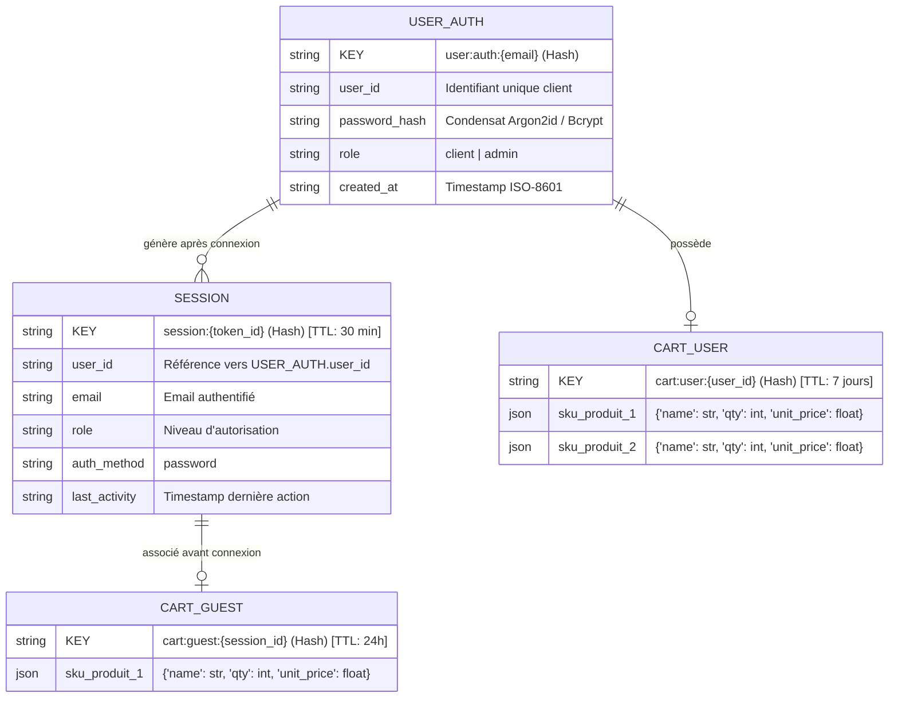

# Schéma de Base de Données Redis — Lot 2 (Panier & Sessions)

Puisque **Redis** est une base de données NoSQL orientée **Clé-Valeur (*In-Memory*)** sans schéma rigide (*schemaless*), ce document formalise la convention de nommage des clés (*keyspace design*), les structures de données utilisées, les formats des valeurs ainsi que les politiques d'expiration (**TTL**).

---

## 1. Vue d'Ensemble du Modèle de Données (Diagramme ER-Like)



---

## 2. Spécifications Détaillées des Clés

### 2.1. Comptes Utilisateurs (Authentification)
* **Pattern de Clé :** `user:auth:<email>`
* **Exemple :** `user:auth:client@ldlc.com`
* **Type Redis :** `HASH`
* **Politique TTL :** Persistant (`TTL = -1`, aucune expiration automatique)

| Champ (*Field*) | Type | Obligatoire | Description & Contraintes |
| :--- | :--- | :--- | :--- |
| `user_id` | `String` | Oui | Identifiant unique du client du Lot 1 (ex: `"C000001"`). |
| `password_hash` | `String` | Oui | Mot de passe haché avec sel (Argon2id ou Bcrypt). Jamais en clair. |
| `role` | `String` | Oui | Rôle applicatif (`"client"`, `"pro"`, `"admin"`). |
| `created_at` | `String` | Oui | Date de création du compte au format ISO-8601. |

---

### 2.2. Sessions Actives de Navigation
* **Pattern de Clé :** `session:<token_id>`
* **Exemple :** `session:a8f5c9e2-4b71-4d3a-9e11-f23456789abc`
* **Type Redis :** `HASH`
* **Politique TTL :** **1800 secondes (30 minutes)** — *Sliding expiration* (renouvelé à chaque requête).

| Champ (*Field*) | Type | Obligatoire | Description & Contraintes |
| :--- | :--- | :--- | :--- |
| `user_id` | `String` | Oui | Identifiant de l'utilisateur connecté (`"guest"` si anonyme). |
| `email` | `String` | Non | Adresse e-mail de l'utilisateur authentifié. |
| `role` | `String` | Oui | Rôle permettant le contrôle d'accès sur tous les serveurs web. |
| `auth_method` | `String` | Oui | Méthode d'authentification (`"password"`, `"anonymous"`). |
| `last_activity` | `String` | Oui | Horodatage Unix de la dernière interaction. |

---

### 2.3. Panier Utilisateur Connecté
* **Pattern de Clé :** `cart:user:<user_id>`
* **Exemple :** `cart:user:C000001`
* **Type Redis :** `HASH`
* **Politique TTL :** **604800 secondes (7 jours)** d'inactivité.

| Champ (*Field*) | Valeur (*Value*) | Format de la Valeur (JSON Sérialisé) |
| :--- | :--- | :--- |
| `P000001` | `String` (JSON) | `{"name": "AMD Ryzen 7 7800X3D", "qty": 1, "unit_price": 449.95}` |
| `P000003` | `String` (JSON) | `{"name": "Corsair Vengeance DDR5 32 Go", "qty": 2, "unit_price": 119.90}` |

*Contraintes sur l'objet JSON embarqué :*
* `name` (`String`) : Libellé court du produit pour affichage immédiat sans appel au Lot 1.
* `qty` (`Integer`) : Quantité commandée (strictement $> 0$).
* `unit_price` (`Float`) : Prix unitaire TTC figé au moment de l'ajout au panier.

---

### 2.4. Panier Visiteur Non Connecté (Invité)
* **Pattern de Clé :** `cart:guest:<session_id>`
* **Exemple :** `cart:guest:a8f5c9e2-4b71-4d3a-9e11-f23456789abc`
* **Type Redis :** `HASH`
* **Politique TTL :** **86400 secondes (24 heures)** d'inactivité (limitation de l'empreinte mémoire RAM).
* **Structure :** Identique au panier utilisateur connecté (`<sku_produit>` $\rightarrow$ JSON `{name, qty, unit_price}`). En cas de connexion, le contenu est fusionné dans `cart:user:<user_id>` puis la clé `cart:guest:<session_id>` est supprimée via `DEL`.

---

## 3. Script d'Initialisation du Schéma (`init_redis.redis`)

Ce script permet d'initialiser un jeu de données de référence conforme au schéma ci-dessus via `redis-cli` :

```redis
-- 1. Création d'un compte utilisateur de test (mot de passe haché)
HSET user:auth:jean.dupont@ldlc.com user_id "C000001" password_hash "$2b$12$eImiTXuWVxfM37uY4JANjQ==" role "client" created_at "2026-11-18T14:00:00Z"

-- 2. Création d'une session active (TTL 30 min)
HSET session:a8f5c9e2-4b71-4d3a-9e11-f23456789abc user_id "C000001" email "jean.dupont@ldlc.com" role "client" auth_method "password" last_activity "1731938400"
EXPIRE session:a8f5c9e2-4b71-4d3a-9e11-f23456789abc 1800

-- 3. Initialisation du panier associé avec prix unitaire (TTL 7 jours)
HSET cart:user:C000001 P000001 '{"name": "AMD Ryzen 7 7800X3D", "qty": 1, "unit_price": 449.95}'
HSET cart:user:C000001 P000003 '{"name": "Corsair Vengeance DDR5 32 Go", "qty": 2, "unit_price": 119.90}'
EXPIRE cart:user:C000001 604800
```